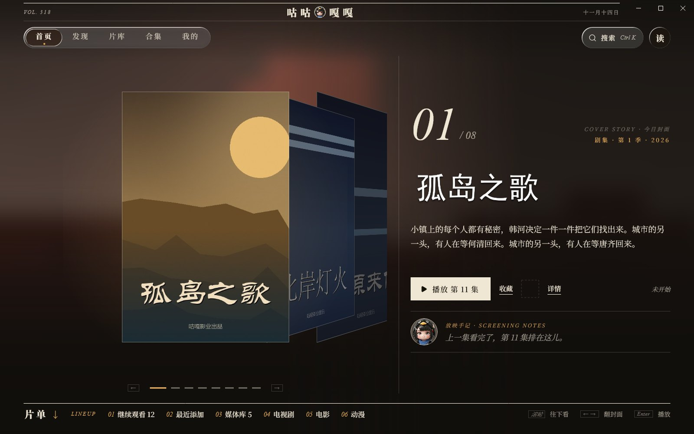
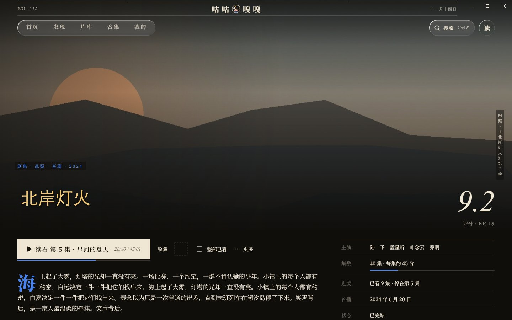
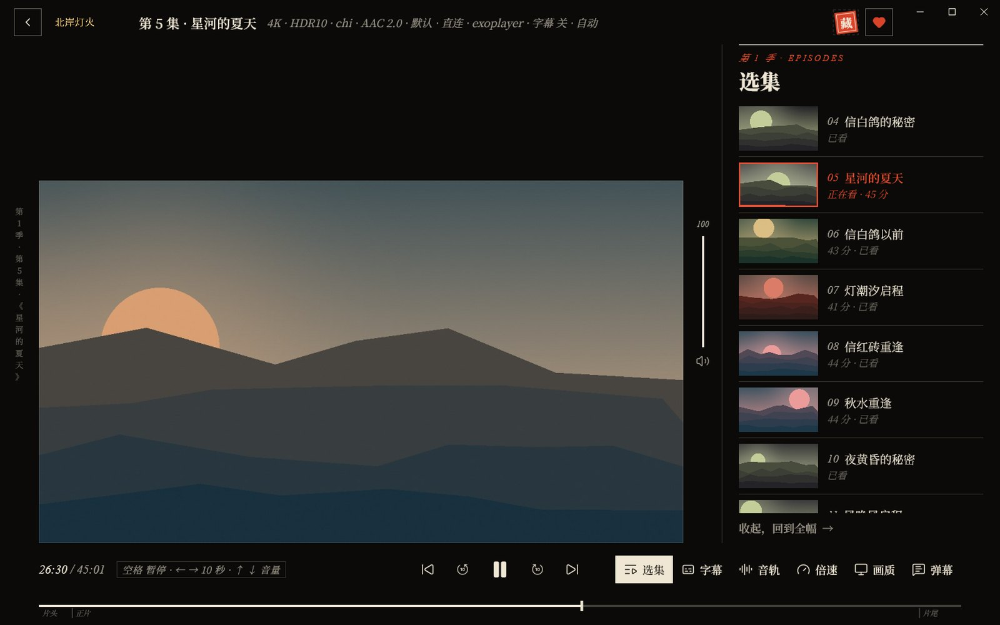
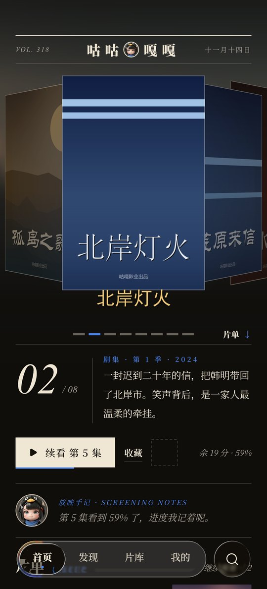
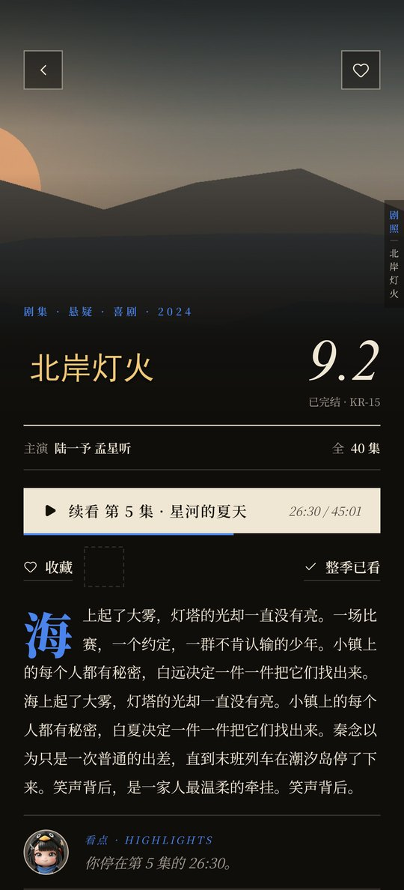
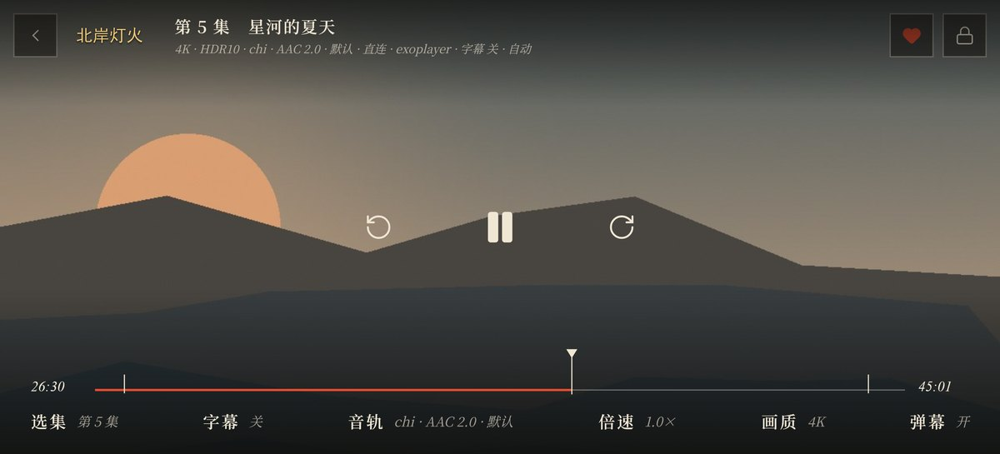
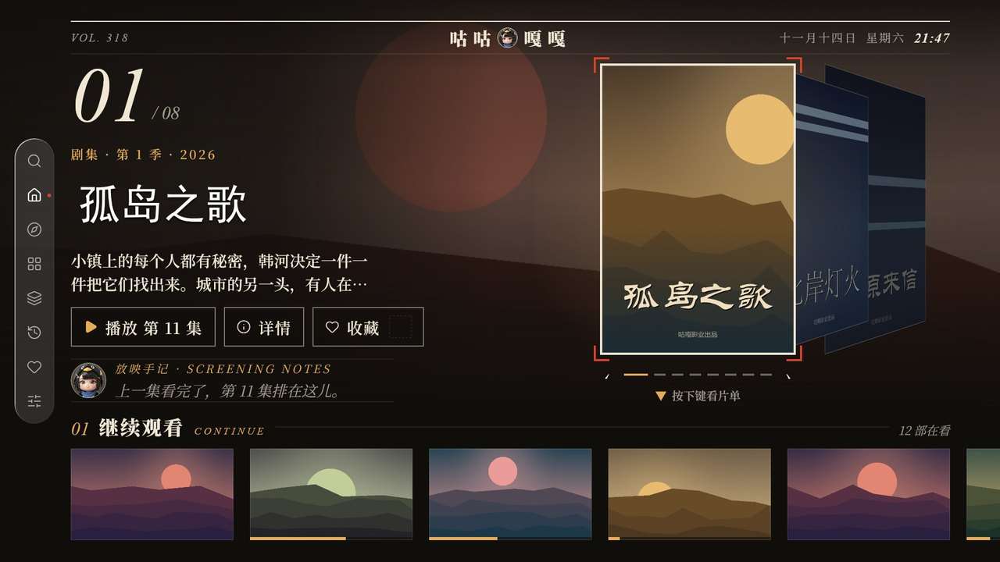
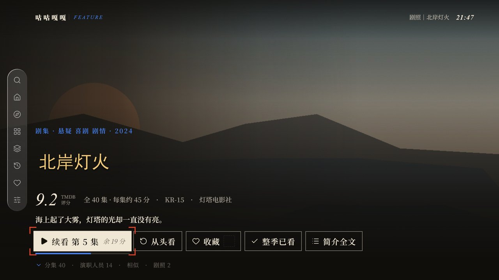
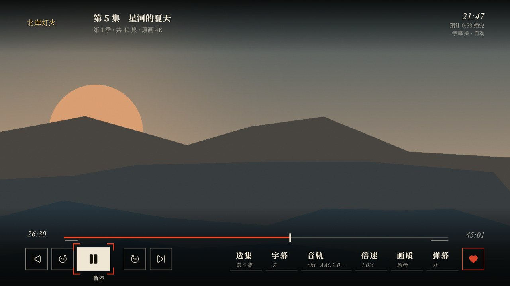

<div align="center">


# 咕嘎画报 · EMBY

**把你的 Emby 片库，排成一份每天出刊的画报。**

安卓手机 · 安卓电视 · Windows · macOS · iPhone（测试版）

[](https://github.com/camille3344520/gugaart/releases)
[](https://github.com/camille3344520/gugaart/releases)
[](LICENSE)

[下载](#下载) · [截图](#截图) · [功能](#功能) · [安装](#安装) · [常见问题](#常见问题) · [致谢](#致谢)

</div>

**咕嘎画报**是一个第三方 Emby 客户端，安装后的应用名叫「咕咕嘎嘎」。它不想做又一个海报网格：

- 打开就是封面：立体海报流、电影原版的艺术字标题、放映手记；
- 点进去，整幅剧照铺满屏幕；
- 吉祥物咕咕嘎嘎是这里的放映员，会在空页、加载、出错时出来陪你。她从不挡内容，播放时也不出现；
- 观影称号：看过的部数到了就升级（十级，从「入场观众」到「观影宗师」），还有四十八个看「怎么看」的特别称号（夜猫子、二刷、跨年放映、压箱底……），每个都有自己的徽章。

播放、弹幕、Emby 连接沿用「咕咕嘎嘎」原生播放器的内核：

- 安卓：ExoPlayer → VLC → mpv 自动回退；
- Windows：内置 mpv，也可以用本机装的 VLC；
- macOS：内置 libmpv（MPVKit），画面直接画在应用窗口里。

## 截图

> 截图里的片名、海报、剧照都是虚构的示例，不是真实影片。

<details open>
<summary><b>Windows</b></summary>
<br>


| 剧集详情 | 播放器 · 选集面板（画面让位） |
|---|---|
|  |  |

</details>

<details>
<summary><b>安卓手机</b></summary>
<br>

| 首页 | 剧集详情 |
|---|---|
|  |  |


</details>

<details>
<summary><b>安卓电视</b></summary>
<br>


| 剧集详情 | 播放器 |
|---|---|
|  |  |

</details>

## 功能

- **封面**：
  - 从片库里挑几部做封面，每 10–20 分钟换一批，不动时自己轮播；每次放映从这部作品的剧照里随机挑一张，最清晰的优先（有 4K 用 4K）；
  - 下面是片单：继续观看、最近添加、媒体库、电视剧、电影、动漫、综艺。
- **整幅铺满的详情页**：剧照占满屏幕；标题用 TMDB 的电影原版艺术字；分集、彩色演员头像、印章式的收藏。
- **发现**：新到的排在前面，高分片每次换一批。
- **片库**：筛选、排序、海报墙，列数随屏幕变化；拼音首字母搜索。
- **搜索**：片名、单集、演员、年份、题材，拼音首字母也行（打演员名字时演员和 ta 的作品排在前面）；没输入时是「找过」和片库词云，点一下就搜。
- **播放器**：
  - 自动选内核、自动回退；
  - 调字幕 / 音轨 / 画质时画面缩到一边让位，面板不挡画面；
  - 跳过片头、自动下一集。
- **字幕自动选**：默认跟随你在这部片上次的选择；新片子按规则选：中文对白不开字幕，外语片自动选中文（简体优先）。也可以设成总是关闭 / 总是中文。
- **弹幕**：
  - 接你自己的弹幕服务器，可以填好几台：同时去匹配，哪台先匹配上就先用哪台；按 TMDB 身份匹配，有分歧时从左边滑出候选让你挑，也可以自己搜；
  - 画面上方有黑边时，弹幕跑在黑边里；
  - 热度条告诉你哪一段最热闹；
  - 可以导入自己的字体。
- **观影称号**：十级等级称号 + 四十八个特别称号，拿到时出一张纸片；首页报头每次打开随机挂一个最近拿到的；「我的」里左右翻页看全部徽章。
- **Trakt**：用短码连接 Trakt 账号（电视上也方便）；看的时候自动记到 Trakt，手动标已看也同步；Trakt 上看过的可以同步回 Emby；剧集详情页一键追更，发现页有追更日历。
- **配置备份与还原**：设置、弹幕服务器、服务器地址打成一份备份，手机、电视、电脑三端通用；导出成文件，或者存到 WebDAV（坚果云、Nextcloud、群晖……）。备份不带登录令牌。
- **三端各自的手感**：
  - 手机：触摸手势；
  - 电视：遥控器从头到尾能用，有焦点框、长按菜单、闲置自动回首页；
  - Windows：报头就是窗口标题栏，有右键菜单和快捷键（`Ctrl K` 搜索、`V` 收藏、`W` 已看）。
- **液态玻璃**：只用在底栏和几颗固定按钮上，其余都是纸面和铅字。

## 下载

到 [Releases](https://github.com/camille3344520/gugaart/releases) 下载：

| 设备 | 文件 | 系统要求 |
|---|---|---|
| 📱 安卓手机 / 平板 | `gugaart-<版本>-phone.apk` | Android 13 及以上 |
| 📺 安卓电视 / 盒子 | `gugaart-<版本>-tv.apk` | Android 9 及以上（ARM） |
| 💻 Windows | `gugaart-<版本>-windows.msi` | Windows 10 / 11，64 位 |
| 🍎 macOS | `gugaart-<版本>-macos.dmg` | macOS 27.2 及以上，Apple 芯片（1.3.0 起） |
| 📱 iPhone（测试版） | `gugaart-<版本>-ios-unsigned.ipa` | iOS 15 及以上；**未签名**，要自己签名后安装（1.3.0 起） |

- 每个版本都附 `SHA256SUMS.txt`。
- 安卓包都用同一张专用证书签名，以后的版本可以直接覆盖安装（证书指纹见[常见问题](#常见问题)）。
- 可以和旧版「咕咕嘎嘎」原生播放器同时安装，互不影响。

> [!NOTE]
> **更新由你决定**：应用启动时检查一次新版本（也可以在 设置 › 关于 里手动检查）。有新版本时弹出一张「号外」，你来选：
> **下载并安装** · **忽略这一版** · **稍后**。
> 不会自己下载，也不会自己安装；登录和设置都会保留。
>
> 更新文件来自本仓库的 Releases，清单有签名，下载后校验 SHA-256，不对就不装。国内网络访问 GitHub 慢时，检查或下载可能失败，可以稍后再试。

## 安装

**安卓手机**：

1. 下载 `…-phone.apk`，点开安装；
2. 系统提示「禁止安装未知来源应用」时，按提示允许这一次。

**安卓电视 / 盒子**：

- 用 U 盘把 `…-tv.apk` 拷到电视，用电视自带的文件管理器打开安装；
- 或者用局域网 adb：
  ```
  adb connect <电视的 IP>:5555
  adb install -r gugaart-<版本>-tv.apk
  ```

**Windows**：双击 `…-windows.msi`。

- 装在当前用户下，不需要管理员权限；开始菜单里叫 `GugaArt`。
- 第一次运行如果出现「Windows 已保护你的电脑」：点「更多信息」→「仍要运行」。安装包还没有购买代码签名证书。

**macOS**：双击 `…-macos.dmg`，把「咕咕嘎嘎」拖到「应用程序」。

- 安装包没有经过 Apple 的公证。**第一次打开**会被系统拦下：先点「完成」，再到「系统设置 › 隐私与安全性」里找到「已阻止使用“咕咕嘎嘎”」，点「仍要打开」并确认；以后就不用了。会用终端的也可以 `xattr -dr com.apple.quarantine /Applications/咕咕嘎嘎.app`。
- 有新版时号外的「下载安装包」会下载并打开新的 `.dmg`，应用退出，再拖一次替换就好；登录和设置都会保留（令牌在钥匙串里）。

**iPhone（测试版）**：`…-ios-unsigned.ipa` 是**未签名**的（不上 App Store），用 AltStore、Sideloadly 或你自己的开发者证书签名后安装；用免费 Apple ID 签的 7 天后要重新签。

**第一次打开**：

1. 点「添加服务器」，填你的 Emby 地址、用户名和密码；
2. 想要弹幕或更好的元数据：在设置里填你自己的弹幕服务器地址和 TMDB 令牌。

安装包里**不带任何人的服务器、账号或令牌**；应用不带统计和广告，只连你填的服务器。

## 常见问题

<details>
<summary><b>怎么确认下载的文件没被改过？</b></summary>

和同一个 Release 里 `SHA256SUMS.txt` 的值比对：

- Windows：`certutil -hashfile <文件> SHA256`
- macOS / Linux：`shasum -a 256 <文件>`

安卓包的签名证书 SHA-256 指纹：

```
51:98:10:32:E5:0A:F5:C9:FF:3F:4E:F6:5B:BC:AF:38:58:EB:C5:1F:63:DE:41:E4:66:66:67:27:9D:7A:B8:37
```

指纹不同的安装包不是我们发布的。
</details>

<details>
<summary><b>以前的版本为什么带「Pre-release」标记？</b></summary>

0.1.x 是预览版：功能基本可用，但还有写明的已知问题。1.0 起是正式版。
</details>

<details>
<summary><b>为什么某些片子默认不开字幕？</b></summary>

「智能」规则把中文对白的片子当作已经烧录了字幕（国产剧大多如此），避免两层字幕叠在一起。可以在设置里改成「总是中文」，或者在播放器里手动打开，以后这部片会记住你的选择。
</details>

<details>
<summary><b>片单里为什么没有「综艺」？</b></summary>

综艺栏要从你的片库里认出综艺：媒体库名含「综艺」，或题材是真人秀 / 脱口秀 / 综艺等。认不出来时这一栏不显示。
</details>

<details>
<summary><b>这个仓库里有什么？</b></summary>

界面层的代码（三端共用的页面、手机 / 电视 / Windows 外壳）和设计稿（`design/`）。播放内核、弹幕、Emby 接口来自「咕咕嘎嘎」原生工程，那部分没有公开，所以这个仓库不能单独编译。问题和建议请开 [Issue](https://github.com/camille3344520/gugaart/issues)。
</details>

## 致谢

- [mpv](https://mpv.io/) / [libmpv](https://github.com/mpv-player/mpv)、[VLC](https://www.videolan.org/)、[ExoPlayer / Media3](https://github.com/androidx/media)：播放内核
- [Compose Multiplatform](https://www.jetbrains.com/compose-multiplatform/)、[Kotlin](https://kotlinlang.org/)：三端界面
- [Kyant Backdrop](https://github.com/Kyant0/AndroidLiquidGlass)：液态玻璃
- [Noto Serif SC](https://fonts.google.com/noto/specimen/Noto+Serif+SC)（SIL OFL 1.1）：界面字体
- [Emby](https://emby.media/)、[TMDB](https://www.themoviedb.org/)：媒体服务器与元数据
- 第三方组件的许可证见 [shell-desktop/packaging/NOTICE.md](shell-desktop/packaging/NOTICE.md)

本项目与 Emby、TMDB 没有隶属关系，也不提供任何影音内容。

## 许可证

[GPL-3.0](LICENSE) © 咕嘎画报 · EMBY 的贡献者

## 赞助

觉得好用的话，可以请作者喝杯奶茶 🧋 —— 不赞助也完全没关系，所有功能都免费，Star 一下就是最大的支持。

<table>
  <tr>
    <td align="center"><br><b>支付宝</b></td>
    <td align="center"><br><b>微信</b></td>
  </tr>
</table>
